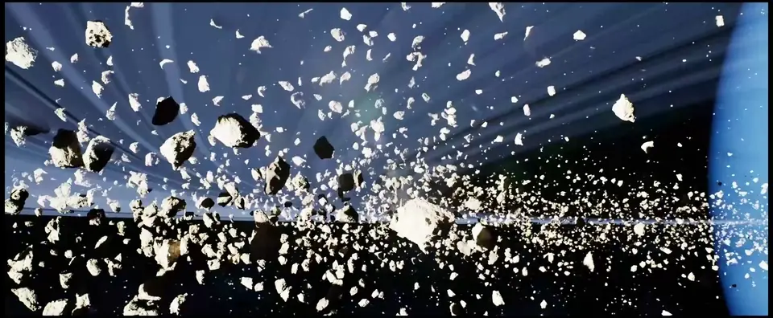

<div align="center">

# AsteroidDrift

**Décor spatial temps réel pour mur LED de production virtuelle, réalisé sous Unreal Engine 5**


<a href="https://youtu.be/3_x7bD10yTY"></a>

**[▶ Voir le render complet sur YouTube (3840 × 1580, 1 min 53)](https://youtu.be/3_x7bD10yTY)**

</div>

---

## Le projet

AsteroidDrift est un environnement spatial pensé pour être diffusé sur un **mur LED de 8,5 m × 3,5 m**. La caméra dérive lentement à travers un anneau d'astéroïdes éclairé par une étoile, avec une planète qui entre progressivement dans le cadre.

Le décor sert de fond de tournage ou d'habillage scénique : il doit fonctionner à très grande échelle, être filmé par une caméra sans artefacts gênants et éclairer de façon crédible les personnes placées devant l'écran.

## Galerie

<p align="center">
  
  
</p>
<p align="center">
  
  
</p>

<p align="center"><sub>Images extraites du render final (3840 × 1580).</sub></p>

## Ce que le projet montre

| Compétence | Mise en œuvre dans AsteroidDrift |
|---|---|
| **Direction artistique** | Ambiance space opera : noir profond, lumière stellaire dominante, anneau planétaire qui structure l'horizon. Éléments clés placés dans la moitié haute du cadre, la partie basse du mur étant souvent masquée par les intervenants ou le décor physique. |
| **VFX temps réel** | Champ d'astéroïdes piloté par un système **Niagara** (`NS_Asteroid`) et un Blueprint dédié (`BP_Asteroid`) : des milliers de rochers instanciés avec variations d'échelle, de rotation et de densité. |
| **Look-dev et matériaux** | Matériaux maîtres et instances pour les astéroïdes, l'anneau (alpha), l'étoile émissive et la planète. Rochers photogrammétriques Megascans (Nanite) mélangés à des formes procédurales. |
| **Éclairage** | **Lumen** en ray tracing matériel, une source stellaire unique qui produit contre-jours, god rays et lens flares, avec un contraste fort entre plans proches et lointains. |
| **Mise en scène caméra** | Séquence réalisée dans **Sequencer** : mouvements lents et continus, parallaxe marquée entre premier plan et arrière-plan pour donner de la profondeur sur une surface de plusieurs mètres. |
| **Pipeline production virtuelle** | Projet configuré pour la diffusion sur mur LED : nDisplay, Live Link, caméra virtuelle, Remote Control et entrées/sorties vidéo (AJA, Blackmagic) activés. Rendu via **Movie Render Queue** au format natif du mur. |

## Spécifications

| Paramètre | Valeur |
|---|---|
| Support cible | Mur LED 8,5 m × 3,5 m |
| Ratio | ≈ 2,43:1 |
| Résolution de rendu | 3840 × 1580 |
| Cadence du render | 24 images/s |
| Durée du render | 1 min 53 s |
| Format du render | QuickTime `.mov`, H.264 et piste audio AAC stéréo |
| Anti-aliasing | TSR (Temporal Super Resolution) |
| Éclairage global et réflexions | Lumen, ray tracing matériel |

## Outils et technologies

- **Unreal Engine 5.7** : Lumen, Nanite, Niagara, Sequencer, Movie Render Queue, nDisplay
- **Blender** : modélisation et préparation des assets
- **Quixel Megascans / Fab** : rochers photogrammétriques

## Structure du projet

```text
AsteroidDrift/
├── Content/
│   ├── Main.umap                  # Niveau principal (ouvert au lancement)
│   ├── Space.umap                 # Niveau spatial
│   ├── Collections/               # Assets du projet
│   │   ├── BP_Asteroid            # Blueprint du champ d'astéroïdes
│   │   ├── NS_Asteroid            # Système Niagara
│   │   ├── Material/              # Astéroïdes, anneau, étoile, planète
│   │   └── *.jpg / *.png          # Textures planétaires et ciel étoilé
│   ├── Fab/Megascans/             # Rochers photogrammétriques
│   └── ApexNature/                # Rochers et fonctions de matériaux
├── Config/                        # Réglages moteur (Lumen, Nanite, RT...)
└── docs/media/                    # Aperçus utilisés dans ce README
```

## Ouvrir le projet

Prérequis : **Unreal Engine 5.7** et **[Git LFS](https://git-lfs.com/)**. Les assets et les textures sont stockés via LFS.

```bash
git lfs install
git clone https://github.com/Nath9666/AsteroidDrift.git
```

Ouvrez ensuite `AsteroidDrift.uproject`. Le niveau `Main` se charge par défaut. Une carte graphique compatible ray tracing est recommandée, Lumen étant configuré en mode matériel.

## Perspectives

- Déclinaison pour d'autres formats d'écran (mur 6,5 m × 1,5 m, ratio ≈ 4,33:1)
- Version temps réel avec suivi caméra (**nDisplay** et Live Link) pour une parallaxe synchronisée avec la caméra de tournage
- Export en boucle parfaite à 25 i/s pour les captations 50 Hz

## Crédits

- Textures planétaires et ciel étoilé : [Solar System Scope](https://www.solarsystemscope.com/textures/) (CC BY 4.0)
- Rochers photogrammétriques : Quixel Megascans via [Fab](https://www.fab.com/)
- Pack *ApexNature – Dolomites* via Fab

---

<div align="center">

**Nathan Morel**, ingénieur XR et temps réel

[LinkedIn](https://www.linkedin.com/in/nathan-morel-4b993b1b7) · [GitHub](https://github.com/Nath9666)

</div>
